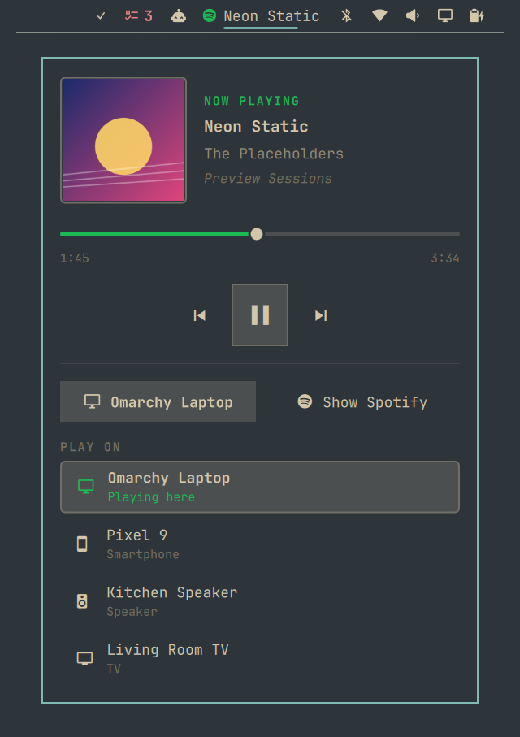
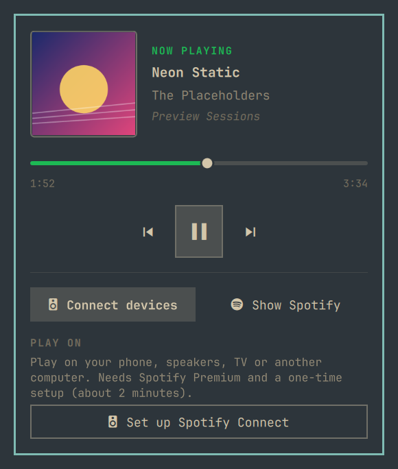

# Segue

**Your music in the [Omarchy](https://omarchy.org) bar, one click from any device.**

Segue is an Omarchy bar plugin for Spotify. It shows the song that's playing,
opens a small media player with cover art and controls, and moves playback to
your phone, speakers or TV with Spotify Connect.



- **In the bar:** the Spotify icon and the song title. Hover to see the artist.
  The icon turns green while music is playing.
- **In the panel:** cover art, title, artist and album, a progress bar you can
  drag, and previous / play-pause / next.
- **Spotify Connect (optional):** see which device is playing and switch to
  another one with a click.

## Quick start

You need **Omarchy 4** and the **Spotify desktop app**. If you don't have
Spotify yet, install it from the Omarchy menu: press **Super + Space**, then
**Install → Service → Spotify**. (The `spotify-launcher` package works too.)

1. Install and turn on the plugin, either from the
   [Omarchy plugin marketplace](https://omarchyplugins.com) or with:

   ```bash
   omarchy plugin add https://github.com/SteveB98/omarchy-segue --enable
   ```

2. Restart the bar so it loads the new plugin:

   ```bash
   omarchy restart shell
   ```

3. Open Spotify and play something. The widget appears on the right side of
   the bar. Click it to open the player.

That's it for the media player. Everything except device switching works now,
with no account setup.

## Optional: switch devices with Spotify Connect

This adds the device button at the bottom of the panel, so you can move what's
playing between this computer, your phone, speakers, a TV, and so on.

**Before you start:** you need **Spotify Premium**. Spotify only allows device
control on Premium accounts.

**Why there's a setup step:** Spotify only lets apps control playback through
its official API, and each person has to register a free "developer app" on
their own account to use it. Nothing gets published and nobody else can see
it. It takes about 2 minutes, and the plugin walks you through it.



1. Click the widget, click **Connect devices**, then **Set up Spotify Connect**.
   A terminal window opens with the steps.
2. Press Enter. Your browser opens Spotify's **Create app** page. Log in if asked.
3. Fill in the form:
   - **App name** and **description:** anything, for example "Segue".
   - **Redirect URI:** paste `http://127.0.0.1:8898/callback` (the setup already
     copied it to your clipboard) and click **Add**. It must match exactly.
   - If it asks which APIs you'll use, tick **Web API**.
   - Accept the terms and click **Save**.
4. On the app's page, copy the **Client ID** (32 letters and numbers) and paste
   it into the terminal.
5. Your browser opens again. Click **Agree**. The terminal shows the devices it
   found, and you're done.

Open the panel and click the device button to see the **Play on** list. Click
any device to move playback there. You only do this setup once: the login is
saved in your system keyring and renews itself.

Prefer the terminal? Run the same steps with:

```bash
~/.config/omarchy/plugins/io.github.steveb98.segue/spotify-connect setup
```

## Controls

| On the bar | Action |
|---|---|
| Left-click | Open the player panel |
| Middle-click | Play / pause |
| Scroll up / down | Previous / next track |
| Right-click | Open Spotify, or bring its window forward |
| Hover | Show the artist (or the show name for podcasts) |

| In the panel | Key |
|---|---|
| Play / pause | `Space` or `Enter` |
| Previous / next track | `←` / `→` |
| Show or hide the device list | `d` |
| Open Spotify | `o` |
| Close the panel | `Esc` |

## Settings

Two settings can be added to the widget's entry in `~/.config/omarchy/shell.json`:

```json
{ "id": "io.github.steveb98.segue", "maxLabelWidth": 220, "brandColor": true }
```

| Setting | Default | What it does |
|---|---|---|
| `maxLabelWidth` | `220` | The widest the song title can get in the bar, in pixels. Longer titles end in "…". Use `0` to show only the icon. |
| `brandColor` | `true` | Spotify green for the icon and progress bar while playing. Set to `false` to use your theme's colors. |

To move the widget, drag it along the bar, or run
`omarchy bar move io.github.steveb98.segue --section left` (or `center`).

## Troubleshooting

**The widget doesn't show up after installing.**
Run `omarchy restart shell`. The bar only picks up new plugins after a restart.
If it's still missing, run `omarchy plugin enable io.github.steveb98.segue`.

**The widget only shows a dim Spotify icon.**
Spotify isn't running. Right-click the icon to open it.

**After updating the plugin, nothing changed.**
Run `omarchy restart shell`. The bar doesn't always reload plugin changes by itself.

**Spotify won't open at all** (it flashes or never appears).
Run `spotify` in a terminal. If you see `GPU process isn't usable. Goodbye.`,
that's a Spotify problem, not this plugin. Tell Spotify to start with
`--disable-gpu-sandbox`:

- **`spotify` package** (what Omarchy's installer uses): add this line to
  `~/.config/spotify-flags.conf`
  (create the file if it doesn't exist):

  ```
  --disable-gpu-sandbox
  ```

- **`spotify-launcher`:** add this to `~/.config/spotify-launcher.conf`:

  ```toml
  [spotify]
  extra_arguments = ["--disable-gpu-sandbox"]
  ```

**Setup: the browser says "Invalid redirect URI" or "INVALID_CLIENT".**
The redirect URI in your Spotify app doesn't match. In the
[developer dashboard](https://developer.spotify.com/dashboard), open your app,
go to **Settings**, and make sure the Redirect URIs list contains exactly
`http://127.0.0.1:8898/callback`. Then run the setup again.

**Setup: the terminal waits and nothing happens after I click Agree.**
Something else on your computer is using port 8898, or the approval took longer
than 3 minutes. Close other copies of the setup and run it again.

**"Spotify refused: Connect control needs Premium."**
Device switching needs Spotify Premium on the account that created the
developer app.

**A device is missing from the list.**
Spotify only lists devices that are on and signed in. Open Spotify on that
device (or wake the speaker) and the list updates within 10 seconds.

**A device is greyed out ("Can't be controlled remotely").**
Spotify reports that device as restricted (some TVs and cars). Start playback
on it from the device itself.

**"Spotify login expired, run setup again."**
Run the setup again. Your developer app is still there, so you only need to
paste the same Client ID.

## Privacy and security

- The Spotify login (a refresh token) is stored in your system keyring through
  `secret-tool`, never in a plain file. The short-lived access token is cached
  in an owner-only folder in memory-backed `$XDG_RUNTIME_DIR` and is gone after
  a reboot.
- Tokens are never passed on a command line, so other accounts on the same
  computer can't read them from the process list.
- The one-time login page only listens on `127.0.0.1` (this computer) and only
  accepts Spotify's redirect for the login you started.
- The only network requests go to Spotify (`accounts.spotify.com` and
  `api.spotify.com`), and only while the panel is open or when you switch devices.
- The plugin asks for two permissions: reading playback state and controlling
  playback. It can't see your playlists, library or account details.
- Like every Omarchy plugin, this runs as unsandboxed code in the Omarchy shell.
  It's three files (`BarWidget.qml`, `spotify-connect`, `manifest.json`), so
  it's quick to read before you enable it. It never asks for admin rights, never
  installs packages, and never edits your configuration files.

## Dependencies

Everything below ships with a standard Omarchy install, so there's nothing
extra to install:

| Used for | Tools |
|---|---|
| The widget | Omarchy shell (Quickshell), Hyprland (`hyprctl`), `jq` |
| Spotify Connect | `curl`, `jq`, `secret-tool` (libsecret), `python3`, `openssl`, `basenc` (coreutils), `xdg-open` (xdg-utils) |
| Setup conveniences | `wl-copy` (copies the redirect URI), `gum` (styled text); both optional |

Spotify Connect also needs a Spotify Premium account and a free Spotify
developer app (the setup walks you through creating it).

## Uninstall

```bash
~/.config/omarchy/plugins/io.github.steveb98.segue/spotify-connect logout   # if you set up Connect
omarchy plugin remove io.github.steveb98.segue
```

You can also delete the developer app from the
[Spotify developer dashboard](https://developer.spotify.com/dashboard).

## How it works

- Track info and playback controls use MPRIS, the standard Linux media-player
  interface, so no account or network access is needed for the player itself.
  The widget only ever controls Spotify, even if another app is playing audio.
- Spotify Connect isn't available through MPRIS, so device listing and switching
  go through the [Spotify Web API](https://developer.spotify.com/documentation/web-api)
  via the small `spotify-connect` script (bash, `curl` and `jq`). Login uses the
  PKCE flow, so there's no client secret to store.

Tested on Omarchy 4.0.4 and 4.0.6. The panel is built from Omarchy's own UI components,
so a future Omarchy update could need a plugin update.

## License

[MIT](LICENSE)
